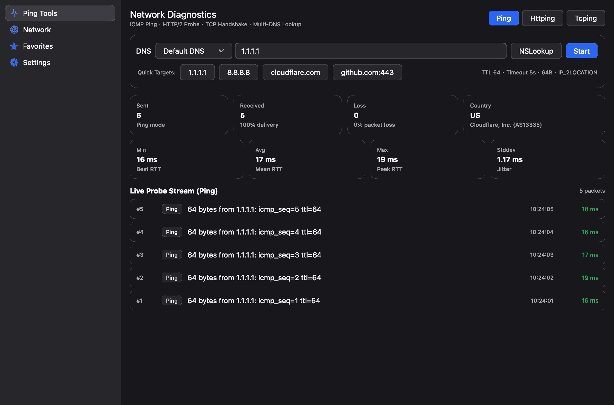

# Linking — Network & Diagnostic Toolkit (MyPHP)

对标 Linking (`agc_raven`) 的跨平台原生网络诊断与智能连接工具箱，基于 [MyPHP](https://github.com/owner888/myphp) 构建。告别 Flutter 臃肿体积，一套纯 PHP 8.4+ / 8.5 声明式视图代码，直接在 macOS、Windows、Linux、iOS 和 Android 的 GPU（Metal / Direct3D 11 / GLES 3）上原生渲染。



## 核心特性 (Features)

- **三合一实时网络探测 (`Ping` / `Httping` / `Tcping`)**：支持 ICMP / Socket 连通性探测、HTTP/2 状态码与首包延迟测量、TCP 指定端口握手测速，实时统计 8 项核心指标（`Sent`、`Received`、`Loss`、`Country`、`Min`、`Avg`、`Max`、`Stddev`）。
- **多 DNS 解析与 IP 归属地库**：内置 `Default DNS`、`114.114.114.114`、`223.5.5.5`、`119.29.29.29`、`8.8.8.8`、`1.1.1.1` 快速切换与一键 `NSLookup` 多 A 记录解析，支持 `IP_2LOCATION` 与 `IP_138` 归属地及 ASN 展示。
- **智能连接与节点管理 (`Network`)**：支持 `VLESS`（含 Reality）、`VMess`、`Trojan`、`Hysteria2`（含 Salamander 混淆）、`Shadowsocks`，订阅支持链接列表、base64、Clash（Mihomo）YAML、sing-box JSON 和 Surge/小火箭配置（`[Proxy]` 段）五种写法，链接支持小火箭自己的 `vmess://` 写法，一键导入、批量延迟测速、分流模式（`Rule` / `Global` / `Direct`）切换与实时上下行速率监控。
- **收藏夹与探测历史 (`Favorites`)**：常用主机与 DNS 节点持久化收藏，支持一键发起 Ping / Tcping / Httping 复测。
- **全平台自适应导航**：基于 `TabViewStyle::sidebarAdaptable`，在桌面端（macOS / Windows / Linux）与 iPad 横屏自动呈现原生毛玻璃侧边栏，在手机端（iOS / Android）自动呈现底部标签栏。

## 运行与开发 (Run)

需要 PHP 8.4+（含 `ext-ffi`）与 `myphp` 框架检出（默认在 `../myphp`，可在 `myphp.json` 的 `framework` 字段配置）：

```sh
myphp dev                  # 桌面端热重载开发
myphp run -d macos .       # 在 macOS 上运行
myphp run -d ios .         # 在 iOS 模拟器或真机上运行（保存即热重载）
myphp run -d android .     # 在 Android 真机或模拟器上运行（保存即热重载）
```

## 无头测试与截图验收 (Test & Screenshot)

```sh
php -d ffi.enable=1 tests/ui_test.php
myphp screenshot -size 1120x740 -theme dark -out /tmp/linking.png .
```

## 打包发布 (Build)

```sh
myphp build -platform darwin/arm64
myphp build -platform android/arm64
myphp build -platform ios/arm64
```
